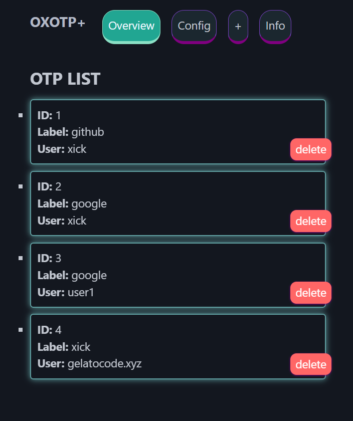
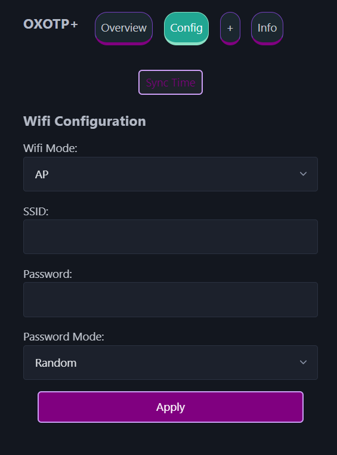
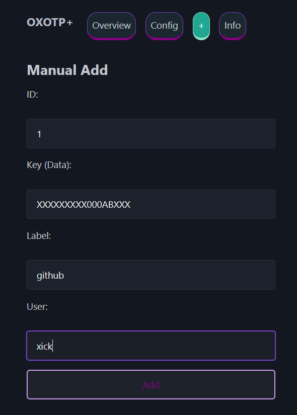
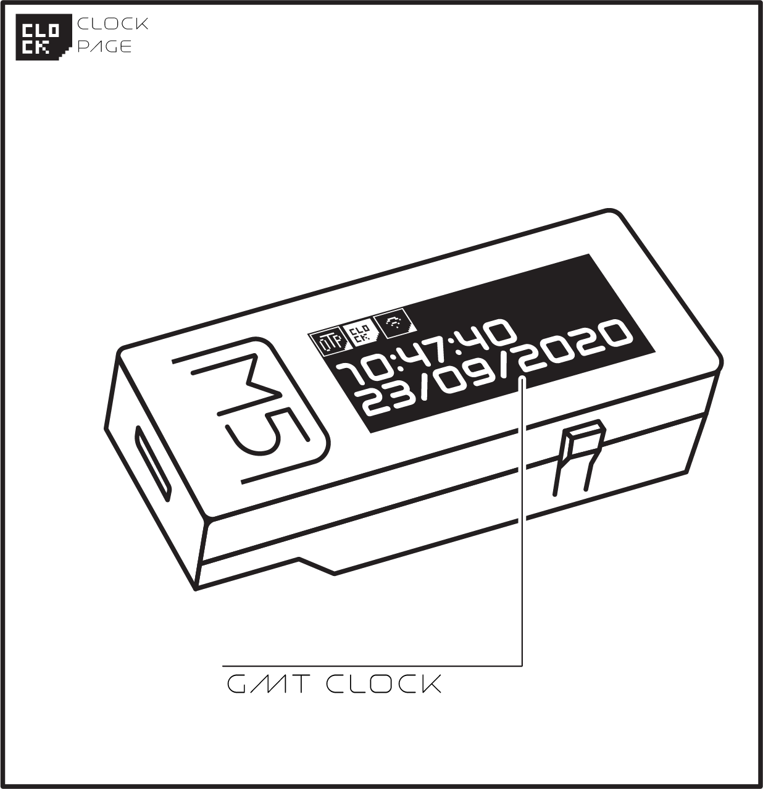

# Aiixi-toy

**M5StickC Plus 2 lifestyle gadget: TOTP authenticator plus weather, air quality, BLE media remote, Uptime Kuma status, level, decibel meter, QR card, photo frame and memos**

Aiixi-toy turns the M5StickC Plus 2 from a single-purpose TOTP token into a pocketable everyday gadget. TOTP stays a first-class app; the device is now an app launcher, and every feature below is one app on it. Settings for all apps live in the WebUI.

The TOTP authenticator in Aiixi-toy is based on [OXOTP-plus](https://github.com/KonradIT/OXOTP-plus) by [KonradIT](https://github.com/KonradIT).

## Apps

| App | Status |
| --- | --- |
| TOTP authenticator (6/8 digits, BLE typing, PIN lock) | Done — BLE typing can be switched off in WebUI Settings (NVS `ble_enabled`, default on; turning it off disconnects the host and stops advertising, turning it back on restarts advertising without a reboot; OTP long-press shows BLE OFF while off) |
| Weather (Open-Meteo) | Done — current temp, condition, high/low, humidity, rain chance; location in WebUI settings (default Taipei); last successful fetch is cached in NVS (15-min freshness) so the screen shows cached data marked CACHED with no network or after a reboot, BtnA forces a refresh |
| Air quality + UV index (Open-Meteo) | Done — US AQI + category, PM2.5/PM10, UV index for the current hour (today's max if the hour is missing); same location as weather; same NVS cache as weather (15-min freshness, CACHED marker offline) |
| BLE media remote (play/pause, next/prev, volume) | Done — Consumer Control over the same BLE HID keyboard as OTP typing; a host bonded before this was added may need to re-pair for the media keys to appear; shows BLE OFF when Bluetooth is switched off |
| Uptime Kuma status | Done — public status page API (https://uptime.aiixi.cc, no key); slug auto-discovered from /api/entry-page, monitor list from /api/status-page/<slug>, latest status + 24h uptime streamed from /api/status-page/heartbeat/<slug> (parsed as a stream, never held whole in RAM); 5 minute cache |
| Level (IMU bubble level) | Done — bullseye bubble, pitch/roll in degrees, LEVEL under 2 degrees, BtnA tares on the current surface |
| Decibel meter (microphone) | Done — RMS level at 16 kHz, ESTIMATE only: SPM1423 datasheet sensitivity (-26 dBFS at 94 dB SPL) gives SPL = dBFS + 120, but the PDM path and case add uncalibrated gain; absolute error is several dB, relative changes are meaningful |
| QR business card | Done — Nayuki qrcodegen (MIT, vendored), https://a1o.uk at ECC medium, 3 px/module on the Plus2; always black on white for scannability |
| Photo frame (slideshow) | Done — JPEGs uploaded in the WebUI (Manage tab), stored in the 4.125MB SPIFFS partition (Plus 2 only): max 20 photos, 500 KB each, 3 MB total; baseline JPEG only (progressive JPEGs are detected and skipped, TJpgDec cannot decode them); scaled to fit, 10 s auto-advance, BtnA next |
| Memo quick view | Done — one memo per line, edited in the WebUI (Manage tab), stored as one NVS string (max 1900 chars, the NVS per-value limit), scrollable list on the device |
| WiFi setup (AP/STA, captive portal, WebUI) | Done |
| Time drift correction | Done |

## App launcher

Every feature is an app in the registry in `include/apps.h` (id, name,
label, blocking `run()` function). The home screen lists the apps:

- **BtnB** moves the selection down (wraps to the first entry)
- **BtnA** enters the selected app
- **BtnB held** leaves the current app and returns home

The toolbar shows the current app's name, the Bluetooth status and the
battery. Apps can be disabled in the WebUI (NVS flag `app_en_<id>`); a
fresh device shows every app. The device PIN lock still guards the whole
device at boot, before the home screen appears.

The order of the home-screen list can be changed in the WebUI too: each
row in the Settings app list has up/down arrows. The order is stored in
NVS as a comma-separated list of app ids under the key `app_order`
(`POST /setAppOrder` with `{"order": [...]}`), and the device applies it
when the home screen is built. With no stored order the registry order
is used; an app missing from the stored order (for example a newly added
app) is appended at the end, and unknown ids are ignored.

The WebUI manages the apps too: Settings has the app on/off list, the
Uptime Kuma base URL and slug, the weather location, and the Bluetooth
on/off switch. Manage has the photo upload and the memo editor. The WiFi Setup app cannot be turned
off: it is the way back to the WebUI.



## HOW TO USE

**1.** Clone locally, using PlatformIO, and build the project for your specific board.

**2.**  For the first time use, by going to the wifi settings the **SSID** and **password** of the access point to connect for the configuration will be printed on screen. The access point is named `Aiixi-toy_<last 6 hex digits of the MAC address>` (e.g. `Aiixi-toy_A1B2C3`). A popup will appear on your phone to login, similar to captive portal from the airport WiFi. Click on it and the website will be loaded.

**3.** On the **configuration** section of the webapp you can also specify your router ssid and password by changing the wireless mode to host (it will automatically fallback to AP mode if connection fails)



**4.** Click '**Sync Time**' to setup the RTC timer of the device (be sure your system / browser time is also correct), this is done automatically by the website config too <br> <br>

**5.** Add OTPs using one of two methods:

**Option A: Paste otpauth:// URI** (Recommended)

- Extract URIs from your existing authenticator app using [**extract_otp_secrets**](https://github.com/scito/extract_otp_secrets)
- Paste the `otpauth://totp/...` URI directly into the parser field
- The form will be auto-populated with the service name, account, and secret

**Option B: Manual Entry**

- Enter the Base32 secret key manually (e.g. `OXXA6YXXVTTP4U25`)
- Fill in the service label and username
- Pick the code length: **6 digits** (default) or **8 digits**, depending on what the service issues. When a URI is pasted, its `digits=` parameter selects this automatically. OTPs added before this option existed keep generating 6 digit codes.



**6.** *(optional)* Pair the device as a Bluetooth keyboard to type codes without retyping them by hand:

- The device advertises as **Aiixi-toy** from the moment it boots, no menu needed
- Pair it from your computer or phone's Bluetooth settings like any other keyboard. The pairing is bonded, so it reconnects on its own afterwards. If the device was paired before the rename, forget the old entry in the host's Bluetooth settings and pair it again — the old name will not reconnect
- A Bluetooth icon appears in the toolbar, next to the battery, while a host is connected
- On the **OTP** screen: a **short press** cycles to the next code (as before), a **long press** types the code that is currently on screen
- The keystrokes use the number row, so a host set to a layout where those keys are not digits without Shift (AZERTY, for example) will receive the wrong characters




### Forgot the device PIN?

If a PIN is set, the device asks for it on boot (button B enters 7, button A enters 8). There is no way to recover a forgotten PIN: the WebUI cannot reach the device either, because the WiFi configurator only starts after the device is unlocked. The only way back in is to erase the flash and re-flash the firmware (e.g. `esptool.py erase_flash`, then upload the firmware again), which also wipes all stored OTP secrets from NVS. Back up your secrets (even on paper) before setting a PIN.

## HOW TO BUILD (PlatformIO - Recommended):

 - Clone the repo
 - Install [PlatformIO](https://platformio.org/) (VS Code extension or CLI)
 - Open the project folder in VS Code with PlatformIO extension
 - Select the target environment:
   - `m5stick-c` for M5StickC
   - `m5stick-c-plus-2` for M5StickC Plus 2
 - Build: `pio run -e m5stick-c-plus-2`
 - Upload: `pio run -e m5stick-c-plus-2 --target upload`

All dependencies are automatically managed by PlatformIO.

### Modifying the Web Interface:

The WebUI is styled with [Tailwind CSS v4](https://tailwindcss.com/).
The source of truth is `web/input.css`; the compiled stylesheet is
`web/tailwind.min.css`, which is gzipped into `include/css.h` by the
header generator and served at `/css/tailwind.min.css`.

The Tailwind standalone CLI is a single binary (no Node needed).
Download it into `tools/` (it is git-ignored, do not commit it):

```bash
curl -L -o tools/tailwindcss https://github.com/tailwindlabs/tailwindcss/releases/latest/download/tailwindcss-linux-x64
chmod +x tools/tailwindcss
```

After changing `web/index.html` or `web/input.css`, rebuild the CSS
and regenerate the C headers:

```bash
./tools/tailwindcss -i web/input.css -o web/tailwind.min.css --minify
go run tools/generate_headers.go
```

Then rebuild the firmware as usual. (Tailwind v4.3.5 was used for the
current stylesheet.)


## DEVELOPED FOR DAILY USE:

Aiixi-toy is intended to be used as an alternative or backup for your currently 2FA authentication app. Using a dedicated device is great because your phone can be easily lost, stolen, hacked, etc. 
Always keep a backup (even on paper) of your secrets if you intend to use this as your main 2FA system.

### MILESTONES
 - ~~Add a battery indicator~~ DONE
 - ~~OTA updates~~  DONE
 - ~~Beautify the UI, add an alternative Light UI~~ DONE
 - ~~Make poweroff timer and screen brightness tweakable~~ DONE
 - ~~Support otpauth:// URI parsing~~ DONE
 
### COMPATIBILITY
- M5StickC Plus 2
- M5StickC

## License 

This software is licensed under the MIT License, to read the full license <a href="LICENSE" target="_blank">HERE</a>.

## Credits

- truetype2gfx - https://rop.nl/truetype2gfx/
- and the creators of all the libraries used.

